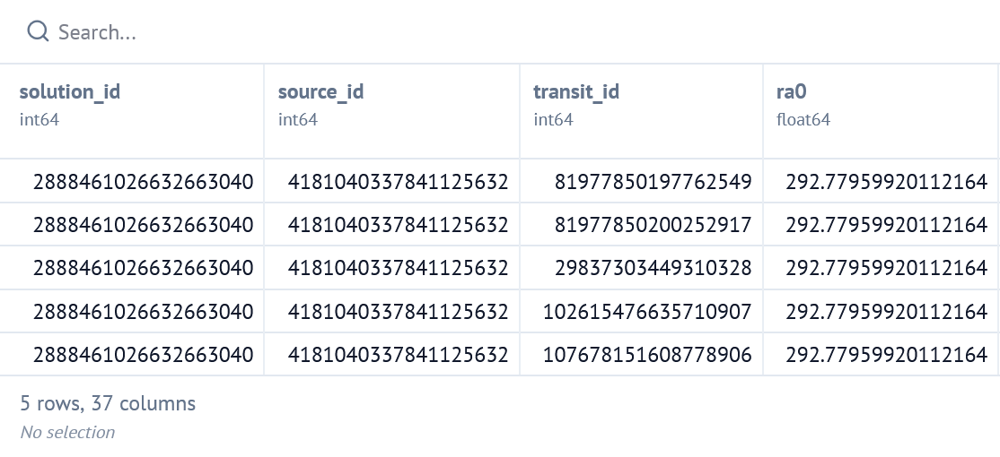
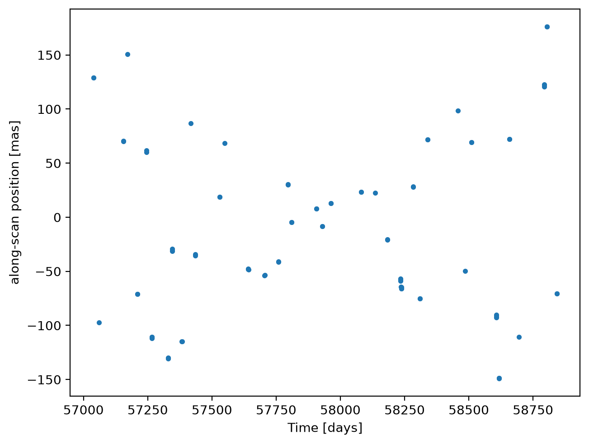
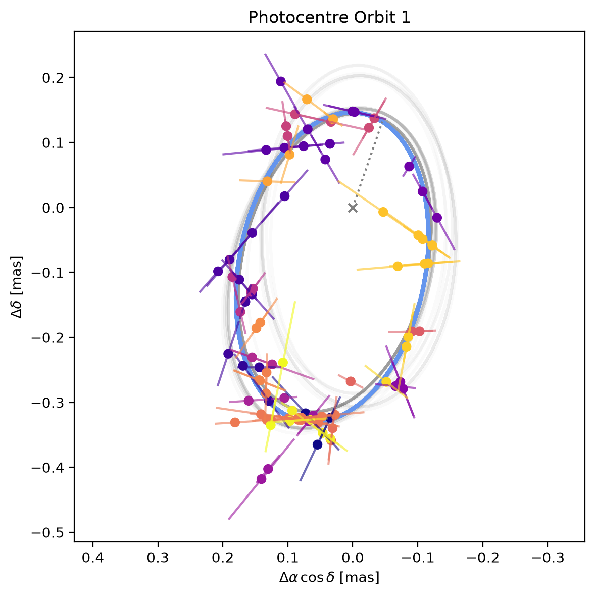
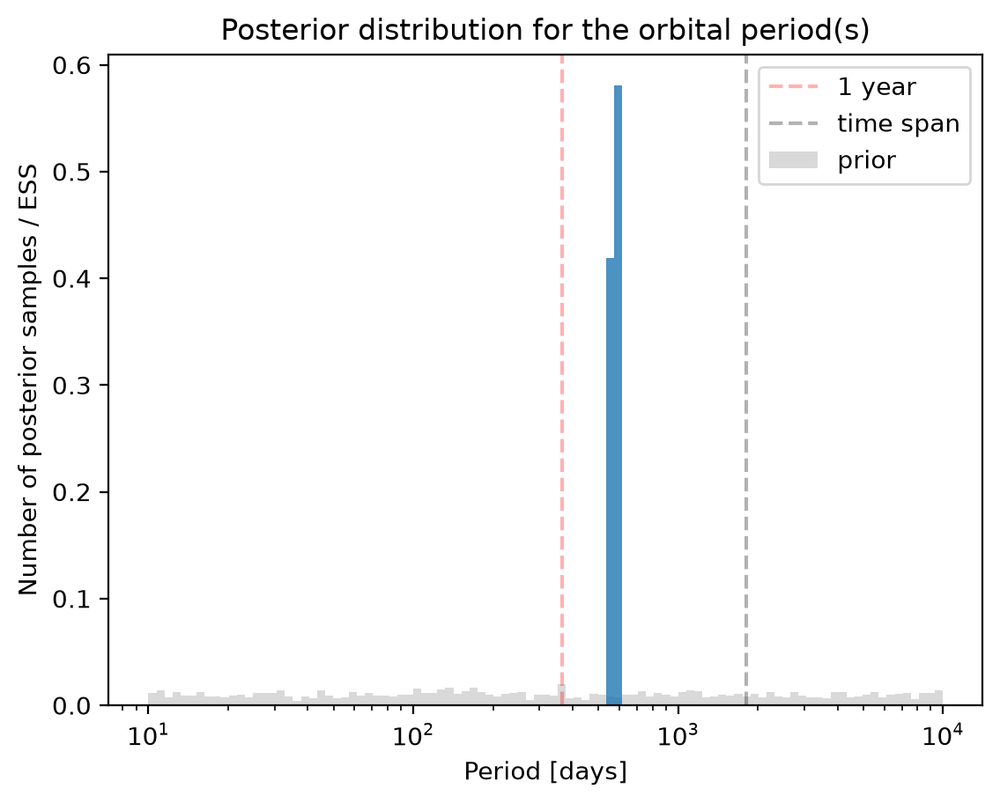
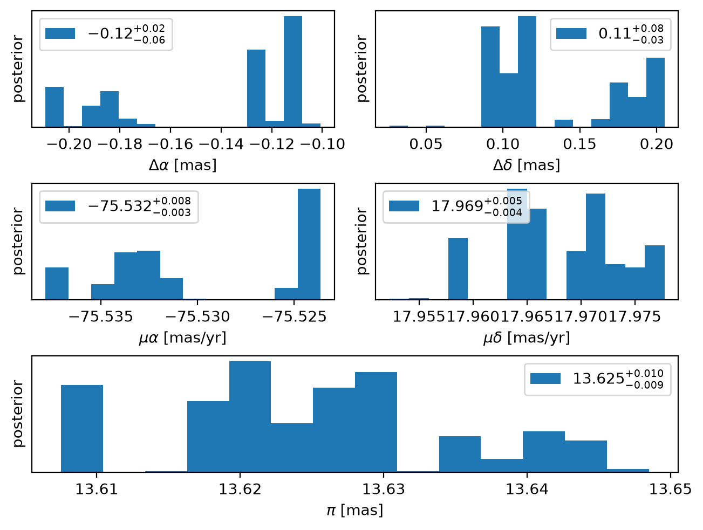
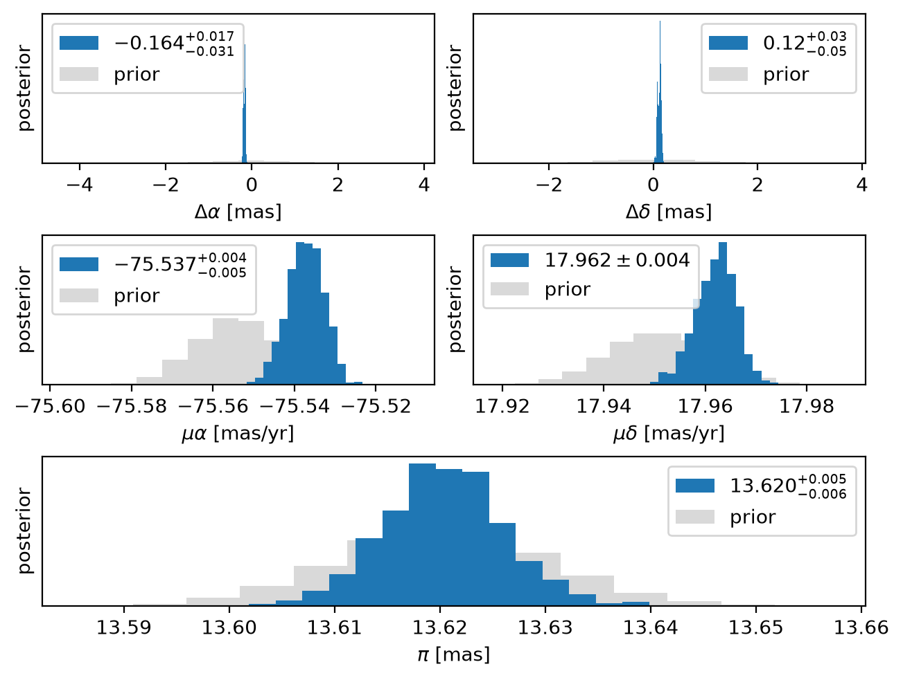

# Gaia DR4

### Introduction

The anticipation is palpable in observatories around the world as ESA prepares the 4th Data Release (DR4) of the Gaia mission. As a teaser, the Gaia DR4 epoch astrometry for 12 sources was pre-released in June 2026. Here we use the pre-release data for Gaia-4 to demonstrate how to fit Gaia epoch astrometry with **kima**.

This example uses the recently developed [GAIAmodel](/docs/API/kima/#kima.GAIAmodel), which is described in detail in Baycroft, Faria & Delisle (2026)[^1].

!!! abstract "Checkout the paper"

    *Bayesian analysis of Gaia epoch astrometry and radial velocities with kima* </br>
    Baycroft, T.A., Faria, J.P., Delisle, J.-B. </br>
    A&A 714, A288 (2026)
    [DOI](https://doi.org/10.1051/0004-6361/202661563),
    [arXiv](https://arxiv.org/abs/2606.24132),
    [NASA ADS](https://ui.adsabs.harvard.edu/abs/2026arXiv260624132B/abstract)

!!! note "Credit where credit is due"

    This tutorial uses Gaia DR4 pre-release data as published at </br>
    &nbsp; [https://www.cosmos.esa.int/web/gaia/dr4-prerelease](https://www.cosmos.esa.int/web/gaia/dr4-prerelease)

    Please read that page and follow the acknowledgement and citation
    instructions [quoted there](https://gea.esac.esa.int/archive/documentation/GDR3/Miscellaneous/sec_credit_and_citation_instructions/) if you use these data.
    Moreover, this tutorial is heavily based on and inspired by the incredible
    [Octofitter documentation](https://sefffal.github.io/Octofitter.jl/dev/gaia-dr4-prerelease/)!

First things first:
Besides **kima**, this tutorial needs `numpy`, `scipy`, `pandas`, `astropy` and `requests`.


```python
import requests
import numpy as np
import pandas as pd
from astropy.table import Table

import kima
```

### Preparing the Gaia data

The [GAIAdata](/docs/API/kima/#kima.GAIAdata) class is used to load Gaia epoch astrometry in **kima**. It expects a simple text file containing at least five columns (in this order):

- observation time,
- along-scan position,
- along-scan position uncertainty,
- scan angle,
- along-scan parallax factor

The pre-release data is not in this format (and neither will be the actual DR4 data), so we need to perform some manipulation of the supplied VOTABLE beforehand. These pre-processing steps are provided here for completeness, but may only be applicable to this specific data release.

#### Downloading the pre-release data

First, the following function will download the zip file provided by ESA and extract the VOTABLE inside it. It only requires the Python standard library, or packages already required by **kima**.


```python
def get_pre_release_data():
    url = "https://anonftp.cosmos.esa.int/pub/GAIA_PUBLIC_DATA/Gaia_DR4/dr4-prerelease/"
    zip_file = "gaia-dr4-prerelease-epoch-astrometry_2026-06-26.zip"

    if not os.path.exists(zip_file): #(1)!
        response = requests.get(url + zip_file)
        with open(zip_file, 'wb') as f:
            f.write(response.content)
        print('Wrote file:', zip_file)

    with zipfile.ZipFile(zip_file) as archive:
        filename = os.path.basename(archive.filelist[0].filename)

        if not os.path.exists(filename): #(2)!
            archive.extract(archive.filelist[0])
            print('Extracted file:', filename)

    return Table.read(filename, format="votable").to_pandas()
```

1. download the zip file if it doesn't already exist
2. extract the xml file if it is not already available

Let's run it and look at the first few rows of the downloaded table


```python
epoch_astrometry = get_pre_release_data()
epoch_astrometry.head()
```


    

    


#### Extracting observations of Gaia-4


This table contains one row per transit for each of the 12 targets included in the release. We are interested in extracting some particular columns for the observations of Gaia-4 (source id 1457486023639239296, the same in DR3 and
DR4). At the same time, several columns are actually arrays, containing the values for each of the 10 CCD observations per field-of-view transit.

!!! note "SM and AF observations"

    Of the 10 entries per transit, the first one comes from the Sky Mapper
    (SM) and is not an astrometric measurement for our purposes. Only the
    other 9, from the Astrometric Field CCDs (AF1–AF9), should be used. The function below discards the SM value.


The helper functions below will extract the rows for a given source, flatten the 10 CCD observations and convert the provided times to modified Julian days. The code is admitedly long, but hopefully simple and documented enough. If you only want to see the data, you can safely skip this section.


```python
def as_int64(series):
    """ convert a pandas column to int64 """
    assert pd.api.types.is_integer_dtype(series.dtype), \
           f'{series.name} has dtype {series.dtype}, expected an integer type'
    return series.to_numpy(dtype=np.int64)


def save_table(filename, df):
    """ save DataFrame to a file, being careful with integer columns """
    fmt = [
        '%d' if pd.api.types.is_integer_dtype(t) else '%.9f'
        for t in df.dtypes
    ] 
    np.savetxt(filename, df.to_records(index=False), fmt=fmt,
               header=' '.join(df.columns))


def extract_source(source_id, epoch_astrometry):
    mask = as_int64(epoch_astrometry['source_id']) == source_id
    rows = epoch_astrometry[mask]
    assert len(rows) > 0, f'source {source_id} not found'

    RA = rows['ra0'].values[0]
    DEC = rows['dec0'].values[0]

    def per_ccd(col, dtype, fill): #(1)!
        stacked = np.ma.vstack(list(rows[col].values)).astype(dtype)
        assert stacked.shape[1] == 10, 'expected SM + AF1-AF9'
        return stacked[:, 1:].filled(fill) #(2)!

    obs_time_tcb = per_ccd('obs_time_tcb', float, np.nan)
    n_ccd = obs_time_tcb.shape[1] #(3)!

    def per_transit(values): #(4)!
        return np.repeat(values, n_ccd)

    df = pd.DataFrame({
        'obs_time_mjd':          55197.0 + obs_time_tcb.ravel() / 86400e9, #(5)!
        'centroid_pos_al':       per_ccd('centroid_pos_al', float, np.nan).ravel(),
        'centroid_pos_error_al': per_ccd('centroid_pos_error_al', float, np.nan).ravel(),
        'scan_pos_angle':        np.deg2rad(per_ccd('scan_pos_angle', float, np.nan).ravel()), #(6)!
        'parallax_factor_al':    per_transit(rows['parallax_factor_al'].to_numpy(float, na_value=np.nan)),
        'ipd_error_al':          per_ccd('ipd_error_al', float, np.nan).ravel(),
        'used_by_agis_al':       per_ccd('used_by_agis_al', bool, False).ravel(),
        'transit_id':            per_transit(as_int64(rows['transit_id'])), #(7)!
    })

    df = df.sort_values('obs_time_mjd', kind='stable', ignore_index=True) #(8)!

    finite = np.isfinite(df.select_dtypes('float')).all(axis=1) #(9)!
    df = df[finite]

    print(len(df), 'CCD observations')

    df = df[df['used_by_agis_al']] #(10)!

    print(len(df), 'used by AGIS')

    filename = f'gaia_{source_id}.txt' #(11)!
    save_table(filename, df.drop(columns='used_by_agis_al'))
    print('wrote to', filename)

    return (RA, DEC), df
```

1. each cell of these columns is an array with the values for the CCDs of one transit
2. the first of the 10 entries is the Sky Mapper (SM) measurement, which is dropped, keeping only the 9 AF measurements
3. should be equal to 9 (AF1–AF9), but just in case
4. quantities that are defined per transit are repeated for each CCD observation
5. convert time from nanoseconds since JD 2455197.5 (TCB) to modified Julian
   days (JD 2455197.5 is MJD 55197.0). This value is in TCB, which is about 20 s
   ahead of TDB in this period; this shouldn't affect our results here
6. the scan angle is provided in degrees, but **kima** needs it in radians
7. keep transit IDs as 64-bit integers
8. sort all rows by time (stable sort keeps the order of the CCDs within a transit)
9. drop CCD observations missing a required value (NaN, including those masked in the VOTABLE)
10. also drop the CCD observations not used by AGIS, following Gaia's internal outlier rejection
11. save the data to a file

Running the function for Gaia-4 will create the text file **kima** needs:


```python
(RA, DEC), df = extract_source(1457486023639239296, epoch_astrometry)
```

    968 CCD observations
    824 used by AGIS
    wrote to gaia_1457486023639239296.txt
    

#### Binning to one observation per transit


We're still not done though: we will also bin the individual CCD observations to one single measurement per transit. As the adage goes, *binning is sinning*, and there is no single best way to do it. We are definitely making assumptions in the statistical treatment of the within-transit observations.

Following the Octofitter tutorial and recommendations from the Gaia team, we will calculate the **median along-scan position per-transit**, and **estimate its uncertainty by bootstrap-resampling** the observations within the transit. To avoid very small uncertainties, we further limit them to the IPD uncertainty divided by the square root of the number of CCD observations.


```python
def bin_by_transit(file=None, df=None, nboot=100, seed=42):
    from scipy.stats import binned_statistic #(1)!

    if file is not None:
        df = pd.read_csv(
            file, sep=r'\s+', comment='#',
            names=['obs_time_mjd', 'centroid_pos_al', 'centroid_pos_error_al',
                   'scan_pos_angle', 'parallax_factor_al', 'ipd_error_al',
                   'transit_id'],
            dtype={'transit_id': np.int64},
        )

    transit_id = df['transit_id'].to_numpy(dtype=np.int64)

    #(2)!
    uid, indices, label = np.unique(transit_id,
                                    return_index=True,
                                    return_inverse=True)

    bins = np.arange(uid.size + 1) - 0.5

    #(3)!
    def binned(values, statistic):
        result = binned_statistic(label, values, statistic=statistic, bins=bins)
        assert np.array_equal(result.binnumber, label + 1), 'something went wrong...'
        return result.statistic

    #(4)!
    time = binned(df['obs_time_mjd'].to_numpy(), 'mean')

    #(5)!
    position = df['centroid_pos_al'].to_numpy()
    position_binned = binned(position, 'median')

    #(6)!
    rng = np.random.default_rng(seed) #(7)!
    def bootstrap_error(x):
        medians = np.median(
            rng.choice(x, size=(nboot, x.size), replace=True), #(8)!
            axis=1
        )
        return np.std(medians)

    error_binned = binned(position, bootstrap_error)

    #(9)!
    floor = binned(df['ipd_error_al'].to_numpy(),
                   lambda x: np.median(x) / np.sqrt(x.size))
    error_binned = np.maximum(error_binned, floor)

    binned_df = pd.DataFrame({
        'obs_time_mjd':          time,
        'centroid_pos_al':       position_binned,
        'centroid_pos_error_al': error_binned,
        'scan_pos_angle':        df['scan_pos_angle'].to_numpy()[indices], #(10)!
        'parallax_factor_al':    df['parallax_factor_al'].to_numpy()[indices],
        'transit_id':            uid,
    }).sort_values('obs_time_mjd', ignore_index=True) #(11)!

    if file is not None:
        binned_file = '_binned'.join(os.path.splitext(file))
        save_table(binned_file, binned_df)
        print('wrote to', binned_file)

    return binned_df
```

1. this function is amazing!
2. get the unique transit IDs and, for each CCD observation, the `label` (0, 1, 2, ...) of the transit it belongs to
3. do the binning and some error checking
4. bin time using *mean* value
5. bin centroid position using median value
6. estimate the uncertainty on the binned centroid position by bootstrap resampling of the centroid position values themselves
7. seeded, so that the result is reproducible
8. this does the bootstrap resampling; increase `nbootstrap` if you want
9. the uncertainty is clipped from below at the median IPD uncertainty divided by the square root of the number of CCD observations
10. scan angles and parallax factors are those of the first CCD observation of each transit
11. `np.unique` sorts by `transit_id`, which is not necessarily the same as sorting by time

Let's create a binned version of the previous file


```python
_ = bin_by_transit(file='gaia_1457486023639239296.txt')
```

    wrote to gaia_1457486023639239296_binned.txt
    

All done! Let's load the data:


```python
data = kima.GAIAdata('gaia_1457486023639239296_binned.txt')
data.plot()
```


    

    


!!! success

    You know it's Gaia data when you can't see the error bars!

### Building the model

Let's build a simple model with one planet (`fix=True` fixes the number of planets to `npmax=1`)


```python
model = kima.GAIAmodel(fix=True, npmax=1, data=data)
```


```python
kima.run(model, steps=20_000, num_threads=2)
```

!!! tip

    Running this model for 20 000 steps with the default settings
    should take only a few seconds, but note (below) we don't get
    a very large effective sample size. Those few posterior samples
    should nevertheless be enough for a first look at the results.

    Also note we didn't have to provide any starting values or
    define any priors.

Let's load the results and make a first plot of the posterior orbits


```python
res = kima.load_results(model)
```

    Loading files took 0.30 seconds
    log(Z) = 101.86
    Information = 59.35 nats
    BMD = 22.71
    Effective sample size = 1419.9
    


```python
res.plot_random_samples()[0]
```

    Astrometry orbit plot depends on the subtraction of the paralactic 
    motion, therefore the set of posterior samples shown will not be truly
    comparable to the data (which is shown with the maximum-likelihood
    paralactic solution removed)
    
    


    

    


The fit looks ok, but this figure must be interpreted with some care (as mentioned in the message that **kima** prints). The Gaia
measurements are one-dimensional (along the scan direction), so to show them on
the sky the contribution of parallax and proper motion has to be subtracted from
the data. This is done with one single solution, here the maximum-likelihood,
whereas the posterior orbits shown above are samples from the full posterior (each
with its own baseline solution). The two are therefore not strictly comparable.

In any case, the orbital period of Gaia-4b is well recovered:


```python
res.plot_posterior_periods(show_prior=True)
```


    

    


The posteriors for the parameters of the background solution can be shown with the following function


```python
res.hist_astrometric_solution()[0]
```


    

    


#### Improving the sampling

As always, **kima** tries hard to have good enough default priors that will work for as many datasets as possible. This does tend to mean that these default priors are quite wide, which can make sampling the posterior a bit more difficult than it could be.

In the `GAIAmodel`, this is especially true for the parameters of the baseline astrometric model (whose posteriors are shown above), for which the default priors will almost always be too wide.

To mitigate this issue, a helper function is provided by *pykima* to create a more adequate set of priors based on the observed data. A linear fit of the baseline 5-parameter single-star model is done to the observed data and the function returns Gaussian distributions around the best-fit values.


```python
from kima.pykima.utils import get_gaussian_prior_astrometric_baseline #(1)!
```

1. competing for the longest function name


```python
baseline_priors = get_gaussian_prior_astrometric_baseline(
    data, sig_mu=0.01, sig_plx=0.01
)

pprint(baseline_priors)
```

    [Gaussian(0; 1),
     Gaussian(0; 1),
     Gaussian(-75.5544; 0.01),
     Gaussian(17.9509; 0.01),
     Gaussian(13.6202; 0.01)]
    

!!! note

    Here we provided values for `sig_mu` and `sig_plx`, but
    the function has defaults (of 0.1)

These priors are for the parameters
$\Delta \alpha^\star$, $\Delta \delta$,
$\mu_{\alpha^\star}$, $\mu_{\delta}$, and $\varpi$
respectively. That is, the offsets from the reference location in right ascension and declination, the proper motions, and the parallax. The two numbers inside each `Gaussian` are the mean and standard deviation.

In the `GAIAmodel` they can be set as


```python
(
    model.da_prior, model.dd_prior, 
    model.mua_prior, model.mud_prior, 
    model.parallax_prior
) = baseline_priors
```

Running the model again with the new priors will typically improve the sampling, even if only modestly.


```python
kima.run(model, steps=20_000, progress_bar=True)
```


```python
new_res = kima.load_results(model)
```

    Loading files took 0.40 seconds
    log(Z) = 123.65
    Information = 40.20 nats
    BMD = 41.06
    Effective sample size = 4167.6
    


```python
new_res.hist_astrometric_solution(show_prior=True)[0]
```


    

    


!!! warning

    The marginal likelihood, log(Z), depends on the priors, so its value
    changes when the baseline priors are changed. Only the effective
    sample size and the posteriors should be compared between the two
    runs. Also note that these priors are built from the data, which are
    then used a second time in the fit. As long as the priors are much
    broader than the posteriors (check the histograms above) the effect on
    the results is negligible.

### Comparison with the published orbit

Gaia-4b was identified from the Gaia DR3 non-single-star (NSS) astrometric
solution, based on 34 months of data, and confirmed with radial velocities by
Stefánsson et al. (2025)[^2]. They also fitted the DR3 solution jointly with
HPF, NEID and FIES velocities. More recently, Barbato et al. (2026)[^3]
monitored the star with HARPS-N and fitted an RV-only orbit to the velocities
plus the literature data.

Let's load a saved model that ran for $100\,000$ steps and get the posterior summaries from the **kima** `res` object:


```python
final_res = kima.load_results('Gaia4_1e5steps.pkl.lz4', verbose=False)
```


```python
from kima.pykima.utils import percentile68_ranges

percentile68_ranges(final_res.posteriors.P)
```


or we can simply print the results directly


```python
final_res.print_results()
```

    logL max: 173.86
    logZ: 108.87
    
        parameter : median ± std           Ͱ                         distribution                         
        jitter    : 0.0241 ± 0.0049        Ͱ     0.0008│▁ ▁▁▁▁▁▁▁▁▁▁▂▂▂▄▄▅▆▇▇▇▇▆▅▄▃▃▂▁▁▁▁▁▁▁ ▁▁│0.0444    
        dd        : 0.160 ± 0.035          Ͱ      0.062│▁▁▁▁▁▁▁▁▁▁▃▂▄▃▄▅▇▄▅▄▂▃▂▃▃▃▂▃▂▁▁▁▁▂▁▁ ▁▁│0.272     
        da        : -0.184 ± 0.024         Ͱ     -0.260│▁▁ ▂▁▁▁▁▂▄▄▂▂▃▅▃▆▇▇▇▆▆▆▆▃▃▂▂▂▁▁▁▂▁▁▁  ▁│-0.102    
        mua       : -75.5324 ± 0.0054      Ͱ   -75.5532│▁▁ ▁▁▁▁▁▂▁▁▂▃▂▃▃▃▄▇▃▅▄▄▄▄▃▂▃▂▂▁▁▁▁▁ ▁▁▁│-75.5124  
        mud       : 17.9665 ± 0.0053       Ͱ    17.9516│▁▁▁▁▁▂▂▂▂▁▃▃▃▃▂▂▃▄▃▄▇▃▃▂▃▂▃▂▁▁▁▁▁▁▁▁▁▁▁│17.9829   
        plx       : 13.621 ± 0.011         Ͱ     13.587│▁▁▁▁▁▁▁▃▁▂▁▂▂▃▅▅▅▅▆▇▄▆▄▂▃▆▃▆▂▃▃▂▁▁▁▁▁▁▁│13.655    
        - planets
        1: P      : 577.2 ± 4.4            Ͱ      561.6│▁▁ ▁▁▁▁▁▁▁▃▄▃▃▆▆▃▃▆▃▆▅▇▄▃▂▂▂▁▁▁ ▁▁ ▁▁ ▁│593.9     
        1: a      : 0.256 ± 0.014          Ͱ      0.218│▁▁▁▁▁▁▂▄▁▄▅▅▂▄▄▄▅▄▇▃▇▆▄▆▄▆▄▃▄▄▅▂▁▂▁  ▁▁│0.292     
        1: M0     : 5.79 ± 0.85            Ͱ       0.00│▁▁ ▁                            ▁▁▃▇▆▂▂│6.28      
        1: e      : 0.402 ± 0.092          Ͱ      0.056│▁   ▁▁▁▁▁▁▁▁▁▁▂▃▂▂▇▃▄▄▅▆▃▅▃▃▂▃▄▂▁▁▁▂▁▁▂│0.641     
        1: w      : 3.6 ± 1.0              Ͱ        0.1│▁ ▁▂▁▁▁▁          ▁▁▁▁▅▅▇▅▂▁          ▁│5.8       
        1: W      : 3.1 ± 1.0              Ͱ        0.0│▂▁▁                                ▁▁▄▇│3.1       
        --
    

The table below summarises all the results, after the necessary unit conversions


<div style="display:none">

```python
# hide-this-cell

from kima.pykima.utils import percentile68_ranges_latex as p68

Mp = final_res.posteriors.msini(0.644, GAIA=True).mean().round(2)

table = mo.md(f"""
| | Gaia DR3 NSS | Gaia DR3 + RVs | RV only | Gaia DR4 pre-release |
|---|---|---|---|---|
| | | Stefánsson+ (2025) | Barbato+ (2026) | this work |
| $P$ [d]        | $564 \pm 11$      | $571.3^{{+1.4}}_{{-1.3}}$     | $588.6^{{+2.2}}_{{-2.5}}$     | {p68(final_res.posteriors.P)} |
| $e$            | $0.51 \pm 0.20$   | $0.338^{{+0.026}}_{{-0.023}}$ | $0.318^{{+0.011}}_{{-0.012}}$ | {p68(final_res.posteriors.e)} |
| $i$ [deg]      | $115.4 \pm 4.6$   | $116.9^{{+4.2}}_{{-4.4}}$     | —   | {p68(np.rad2deg(np.acos(final_res.posteriors.cosi)))} |
| $\omega$ [deg] | $185 \pm 16$      | $180.3^{{+5.5}}_{{-4.8}}$     | —   | {p68(np.rad2deg(final_res.posteriors.w))} |
| $\Omega$ [deg] | $159.4 \pm 5$     | $158.6 \pm 5.1$               | —   | {p68(np.rad2deg(final_res.posteriors.W))} |
| $a_0$ [mas]    | $0.312 \pm 0.040$ | $0.279^{{+0.016}}_{{-0.014}}$ | —   | {p68(final_res.posteriors.a)} |
| $m_\mathrm{{p}}$ [M$_\mathrm{{Jup}}$] | $13.2 \pm 1.9$ | $11.8^{{+0.73}}_{{-0.66}}$ | $\geq 10.30 \pm 0.45$ | {Mp} |
""")
table
```

</div>


<span class="markdown prose dark:prose-invert contents"><table>
<thead>
<tr>
<th></th>
<th>Gaia DR3 NSS</th>
<th>Gaia DR3 + RVs</th>
<th>RV only</th>
<th>Gaia DR4 pre-release</th>
</tr>
</thead>
<tbody>
<tr>
<td></td>
<td></td>
<td>Stefánsson+ (2025)</td>
<td>Barbato+ (2026)</td>
<td>this work</td>
</tr>
<tr>
<td>$P$ [d]</td>
<td>$564 \pm 11$</td>
<td>$571.3^{+1.4}_{-1.3}$</td>
<td>$588.6^{+2.2}_{-2.5}$</td>
<td>$577 ^{+4} _{-5}$</td>
</tr>
<tr>
<td>$e$</td>
<td>$0.51 \pm 0.20$</td>
<td>$0.338^{+0.026}_{-0.023}$</td>
<td>$0.318^{+0.011}_{-0.012}$</td>
<td>$0.40 ^{+0.10} _{-0.08}$</td>
</tr>
<tr>
<td>$i$ [deg]</td>
<td>$115.4 \pm 4.6$</td>
<td>$116.9^{+4.2}_{-4.4}$</td>
<td>—</td>
<td>$123 ^{+5} _{-4}$</td>
</tr>
<tr>
<td>$\omega$ [deg]</td>
<td>$185 \pm 16$</td>
<td>$180.3^{+5.5}_{-4.8}$</td>
<td>—</td>
<td>$208 ^{+11} _{-22}$</td>
</tr>
<tr>
<td>$\Omega$ [deg]</td>
<td>$159.4 \pm 5$</td>
<td>$158.6 \pm 5.1$</td>
<td>—</td>
<td>$176 ^{+3} _{-5}$</td>
</tr>
<tr>
<td>$a_0$ [mas]</td>
<td>$0.312 \pm 0.040$</td>
<td>$0.279^{+0.016}_{-0.014}$</td>
<td>—</td>
<td>$0.256 ^{+0.015} _{-0.017}$</td>
</tr>
<tr>
<td>$m_\mathrm{p}$ [M$_\mathrm{Jup}$]</td>
<td>$13.2 \pm 1.9$</td>
<td>$11.8^{+0.73}_{-0.66}$</td>
<td>$\geq 10.30 \pm 0.45$</td>
<td>10.79</td>
</tr>
</tbody>
</table></span>


A few remarks to be cautious about in this comparison:

- The DR3 solution has large uncertainties (for example $\pm 0.20$ in eccentricity). The DR4 pre-release covers 66 months, about 3.5 orbital periods instead of roughly 1.8 for DR3, so the posteriors obtained here should be consistent with the DR3 values but tighter.

- The RV-only period depends on the model. The value in the table includes a long-term quadratic trend, which Barbato et al. found to be only marginally preferred ($\Delta$BIC = 9.1). A single Keplerian gives $574.5^{+3.1}_{-2.8}$ d and $e = 0.336^{+0.013}_{-0.014}$. These periods differ by more than their formal uncertainties from the joint DR3 + RV solution.

- The companion mass follows from $a_0$, the parallax, the period and the *stellar mass*, which is an external input: estimated as $0.644^{+0.025}_{-0.023}$ M$_\odot$ (Stefánsson et al.) or $0.652^{+0.027}_{-0.025}$ M$_\odot$ (Barbato et al.). We used the former value for the table above.

Finally, remember that the pre-release epoch astrometry is preliminary and may differ in details from the data that will be published in DR4, so the numbers obtained here are best seen as a demonstration rather than a new measurement.

---
### 🚧 marimo setup


```python
import marimo as mo
```


```python
from pprint import pprint
import os
import zipfile
```

### References

[^1]: Baycroft, T.A., Faria, J.P., Delisle, J.-B.
      *Bayesian analysis of Gaia epoch astrometry and radial velocities with kima*
      A&A 714, A288 (2026)
      [arXiv](https://arxiv.org/abs/2606.24132),
      [DOI](https://doi.org/10.1051/0004-6361/202661563)

[^2]: Stefánsson, G., Mahadevan, S., Winn, J.N., et al.
      *Gaia-4b and 5b: Radial Velocity Confirmation of Gaia Astrometric Orbital Solutions Reveal a Massive Planet and a Brown Dwarf Orbiting Low-mass Stars*
      AJ, 169, 107 (2025)
      [arXiv](https://arxiv.org/abs/2410.05654),
      [DOI](https://doi.org/10.3847/1538-3881/ada9e1)

[^3]: Barbato, D., Pinamonti, M., Sozzetti, A., et al.
      *The GAPS programme at TNG LXXV. Validating and confirming Gaia substellar astrometric candidates with HARPS-N*
      A&A 712, A213 (2026)
      [arXiv](https://arxiv.org/abs/2606.29001),
      [DOI](https://doi.org/10.1051/0004-6361/202557585)
